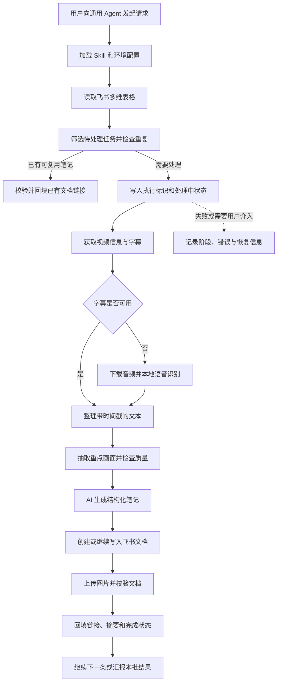

# 视频笔记到飞书：Skill 设计方案

更新日期：2026-10-21
文档状态：设计基线；首版已实现，真实飞书端到端联调待配置（以 README 为当前状态）
建议 Skill 名称：`video-to-feishu-notes`

## 1. 目标与已确定的方向

将日常收集的教程视频整理为结构化图文笔记，并长期沉淀到飞书文档。用户在飞书多维表格中维护视频链接，再通过通用 Agent 发起处理。

核心结构：

> 通用 Agent 执行任务 → Skill 定义流程与质量要求 → 飞书多维表格保存任务状态 → 飞书文档保存笔记。

已确定的设计原则：

- 以 Skill 作为使用入口，不部署独立常驻后台服务。
- 飞书多维表格是任务状态的唯一权威来源，不依赖聊天历史或本地数据库判断任务是否完成。
- 知识库保存日常阅读和编辑的主文档，云盘文件夹保存最初生成内容的备份副本，多维表格分别保存两个链接并承担检索目录的作用。
- 视频获取、转写、截图和飞书接口调用可以使用按需运行的工具或辅助脚本。
- 第一版由用户在 Agent 中主动启动，采用单执行者、串行处理。

本文所说的“飞书表格”默认指飞书多维表格，而非普通电子表格。实际表、目标文件夹、工具授权方式和模型执行环境尚待实现时配置。

## 2. 使用方式与边界

### 2.1 日常使用

1. 用户在飞书多维表格新增视频链接，按需填写学习分类、笔记要求。
2. 勾选“开始生成”，表示允许处理该条任务。
3. 用户在通用 Agent 中说：“处理视频收集表里的待整理视频，最多 3 个。”
4. Agent 加载 Skill，读取飞书任务，逐条生成笔记。
5. Agent 将文档链接、摘要、状态和完成时间回填表格。
6. 用户通过表格的“笔记库”视图阅读、筛选和回看。

建议支持的指令：

- “把这个视频加入收集表，暂时不生成。”
- “处理飞书视频表中的待整理任务，最多 3 个。”
- “只处理学习分类为 AI 的视频。”
- “重试上次失败的任务。”
- “重新生成这条笔记，重点解释代码。”

批量处理必须有数量或其他明确边界。未指定时，建议第一版默认最多处理 3 条；该默认值属于实现建议，可通过配置调整。

### 2.2 不依赖常驻程序的含义

无需独立 Web 后端、常驻轮询进程、本地任务数据库或自行维护的调度服务。但 Agent 仍然需要可调用的工具来访问飞书、获取视频、识别语音和抽帧。

Skill 是操作说明与工具包，执行者是 Agent。仅在表格新增一条记录不会自动唤醒 Skill。新增即执行、定时执行或全天无人值守均需要外部触发能力，不属于第一版范围。

### 2.3 通用 Agent 的最低能力

- 能读取并遵循 Skill 指令。
- 能通过 MCP、连接器或接口脚本读写飞书。
- 能调用视频处理工具；使用本地转写时，需要相应运行环境。
- 能理解转写文本，生成结构化笔记；需要复核截图时，具备图像理解能力。

流程可以通用，但不同 Agent 的工具名称、授权方式和能力不一定相同，需要适配。缺少关键能力时应明确报告，不能静默跳过后声称成功。

## 3. 整体架构



各组件职责：

| 组件 | 职责 |
|---|---|
| 通用 Agent | 解释用户意图、调度工具、理解内容、生成笔记、汇报结果 |
| 主 Skill | 规定任务筛选、执行流程、质量标准、状态更新和恢复规则 |
| 视频工具 | 获取元数据、字幕、音频和截图，执行本地转写 |
| 飞书工具适配层 | 读写表格、操作文档块、上传图片和查询访问情况 |
| 飞书多维表格 | 保存任务输入、状态、去重信息、文档关联与错误信息 |
| 飞书知识库 | 保存日常阅读和编辑的笔记主文档 |
| 飞书云盘文件夹 | 保存生成时的备份副本和必要的草稿 |
| 本地临时目录 | 缓存音频、转写稿、截图等可重新获取的中间材料 |

## 4. 飞书多维表格设计

### 4.1 用户可见字段

| 字段 | 建议类型 | 说明 |
|---|---|---|
| 视频链接 | 文本 | 接受原始链接、短链接或包含链接的分享文本 |
| 开始生成 | 复选框 | 表示用户允许处理；新记录默认不勾选 |
| 处理状态 | 单选 | 待处理、处理中、已完成、失败、待人工处理 |
| 当前阶段 | 单选或文本 | 校验输入、获取字幕、本地转写、截图、生成笔记、写入文档、校验结果 |
| 视频标题 | 文本 | 自动获取 |
| 视频平台 | 单选 | B站、抖音；其他平台后续扩展 |
| 学习分类 | 单选或多选 | 用于筛选和归档 |
| 笔记要求 | 多行文本 | 例如“面向零基础”“重点解释代码” |
| 笔记文档 | 链接 | 最近一次成功生成或复用的主文档；both 模式指向知识库 |
| 备份文档 | 链接 | both 模式下对应的云盘生成备份；单目标模式为空 |
| 内容摘要 | 多行文本 | 便于在表格快速浏览 |
| 重新生成 | 复选框 | 请求生成新版本 |
| 完成时间 | 日期时间 | 最近一次成功完成的时间 |
| 错误信息 | 多行文本 | 用户可理解的失败原因和建议动作 |
| 结果来源 | 单选 | 新生成、复用已有笔记 |

“重复复用”作为结果来源保存，处理状态仍为“已完成”，避免把完成状态和来源混在一起。

### 4.2 默认隐藏的系统字段

| 字段 | 用途 |
|---|---|
| 记录 ID | 使用飞书原生记录标识，定位具体任务 |
| 视频唯一标识 | 平台 + 视频 ID + 分 P 等内容定位信息 |
| 输入指纹 | 视频唯一标识 + 笔记要求 + 模板版本 + 输出语言等影响结果的配置 |
| 执行标识 | 当前批次或执行者的唯一标识 |
| 最近更新时间 | Agent 最近一次确认任务仍在处理的时间 |
| 尝试次数 | 已启动的处理尝试次数 |
| 生成版本 | 当前生成任务对应的版本 |
| 模板版本 | 用于复用判断和版本追踪 |
| 工作文档 ID / 链接 | 当前尚未完成的草稿；与已发布笔记分开保存 |
| 已完成检查点 | 最后确认成功的阶段 |
| 写入进度 | 已写入的逻辑章节及必要的块标识，用于避免重复追加 |
| 复用来源记录 ID | 指向原始成功任务 |

这些系统字段的具体存储形式需要按飞书字段限制确定。第一版可在多行文本字段保存简短结构化检查点，不在表格单元格中塞入完整转写稿、图片或音频。

### 4.3 推荐视图

- **收集箱**：尚未勾选“开始生成”的记录。
- **待处理**：已勾选且状态为待处理的记录。
- **处理中**：展示当前阶段与最近更新时间。
- **笔记库**：仅展示已完成记录，按学习分类分组。
- **需要处理**：失败或待人工处理的记录。

## 5. 状态与任务选择

### 5.1 状态含义

| 状态 | 含义 | 后续动作 |
|---|---|---|
| 待处理 | 尚未开始本次生成 | 勾选开始生成后可被领取 |
| 处理中 | 某次执行正在处理 | 由该执行继续推进 |
| 已完成 | 文档已完成必要校验，表格关联已回填 | 默认跳过 |
| 失败 | 本次执行失败，通常可通过重试恢复 | 用户要求重试或符合本轮重试策略时再处理 |
| 待人工处理 | 缺少权限、授权、有效链接或关键输入 | 用户解决后重新进入队列 |

正常流转：`待处理 → 处理中 → 已完成`。

异常流转：`处理中 → 失败 / 待人工处理`。

重新生成：保留已成功文档，创建新生成版本，任务进入处理中；both 模式创建新主文档和新备份，全部成功后统一替换“笔记文档”和“备份文档”字段。失败时原链接仍然保留，不删除旧文档。重新生成以视频内容为输入，不是对主文档后续手动修改的备份。

### 5.2 领取条件

Agent 需要先分页读取符合用户筛选范围的记录，再在批量上限内处理：

- 链接不为空。
- 用户已勾选开始生成，或本轮明确指定处理该记录。
- 状态为待处理，或用户明确要求重试、重新生成。
- 没有其他仍有效的执行正在处理。

领取时写入执行标识、处理中状态、当前阶段和更新时间，再读取确认。关键阶段完成后更新检查点。

第一版明确要求同一张表只有一个执行者。“读取后更新再确认”只能降低冲突风险，不构成原子锁，不能保证多个 Agent 同时运行时互斥。真正并发领取需要进一步验证飞书接口的条件更新能力或增加专门协调机制。

### 5.3 长时间处于处理中

不能仅凭时间久就断定任务已死亡，本地转写可能耗时很长。

建议将更新时间超时作为“疑似中断”信号，并结合当前执行是否仍在运行判断。能确认原执行已结束时，可在下一次调用中恢复；无法确认时暂不抢占，并向用户说明。超时阈值应可配置，并考虑最长处理步骤的耗时。

## 6. 去重与版本规则

1. 解析短链接和分享文本，取得平台视频标识。
2. 同一 B站视频的不同分 P 作为不同内容处理。第一版以明确的单条视频或单个分 P 为单位，不默认批量处理整套合集。
3. 生成输入指纹，包含视频标识、笔记要求、模板版本和输出语言等配置。
4. 查找同一张表中输入指纹相同的已完成任务。
5. 确认其文档可访问且没有被标记为不完整后，复用链接、摘要及来源记录。
6. 若文档失效，记录原因并按用户授权重新生成或等待处理，不把失效链接标为成功。

不同分享链接可能指向同一个视频，不能只比较 URL 字符串。不同笔记要求不做语义层面的强行合并，第一版宁可分别生成。

用户勾选重新生成时跳过复用，创建新版本。开始执行时记录本次输入快照；结束前再次检查输入是否改变。若视频链接或笔记要求在处理中被修改，不能把旧输入的结果当作新输入已完成，应保留产物并提示需要处理新版本。

## 7. 视频处理流程

### 7.1 复用现有项目

本方案以用户提供的两个项目为参考。已阅读两者 README；下列现有能力来自项目说明，不代表已经审查实现代码或完成运行验证。脚本接口、恢复行为和依赖兼容性须在实施时确认。

| 对比项 | bilibili-douyin-notes | VidLens（映知） | 本方案的选择 |
|---|---|---|---|
| 产品形态 | Agent Skill + Python 脚本 | 完整 Web 应用 | 采用 Skill 形态，由通用 Agent 执行 |
| 视频平台 | B站、抖音、YouTube、小红书视频 | B站、YouTube | 首版使用前者的 B站与抖音能力 |
| 文字来源 | 字幕优先，faster-whisper 本地转写兜底 | 字幕优先，缺失时转写 | 优先复用前者的获取与本地转写流程 |
| 视频画面 | 按时间锚点抽帧、画质初筛、Agent 视觉复核 | 通览视频、查看画面并围绕证据组织内容 | 复用前者抽帧能力，参考后者把画面与具体讲解对应 |
| 笔记结构 | 课堂小节、知识地图、概念卡片、自测题、时间索引 | 章节文章、真实画面、时间出处、内容导图 | 以前者课堂模板为基础，强化来源与图文对应 |
| 处理透明度 | 脚本输出、笔记校验工具 | 页面展示准备、取证、写作、校验过程 | 将关键阶段和检查点记录到飞书表格 |
| 后续追问 | 依赖所在 Agent | 网页内对文章、段落和画面追问 | 后续可由通用 Agent 读取笔记并回查视频，首版暂不实现 |
| 交付方式 | Markdown 与图片 | 网页文章、Markdown、图文 ZIP、只读分享 | 飞书文档 + 表格链接，保留 Markdown 为中间产物 |
| 运行依赖 | Agent 与本地处理环境 | Go、React、PostgreSQL、Redis、FFmpeg 等 | 按需运行工具，飞书保存状态，无独立常驻后端 |

#### 7.1.1 bilibili-douyin-notes：视频处理基础

项目：[lucky-Luor/bilibili-douyin-notes](https://github.com/lucky-Luor/bilibili-douyin-notes)。

README 中列出的候选复用组件：

| 上游组件 | 已描述的用途 | 在本方案中的位置 |
|---|---|---|
| `scripts/bili_fetch.py` | B站元数据与字幕获取，支持探测 | 输入校验、视频去重所需标识、获取字幕 |
| `scripts/douyin_fetch.py` | 抖音元数据与免登录视频下载 | 抖音素材获取 |
| `scripts/bili_transcribe.py` | faster-whisper 本地转写 | 无字幕时的兜底 |
| `scripts/bili_screenshot.py` | PyAV 抽帧及画质初筛 | 提取课堂截图，随后由 Agent 复核 |
| `scripts/transcript_chunk.py` | 长转写稿分块 | 长视频分段理解 |
| `scripts/apply_glossary.py` | 转写术语校正 | 降低专业词识别错误，保留原始材料 |
| `references/note-template.md` | 课堂笔记模板 | 飞书笔记的内容结构基础 |
| `scripts/note_nav.py` | 时间索引与深链填充 | 原视频回看入口；平台跳转能力须验证 |
| `scripts/validate_note.py` | Markdown 笔记质量校验 | 发布前检查之一，另加飞书写入结果检查 |

截图初筛只是标记可疑画面，最终取舍仍需视觉复核，不能把像素规则当成内容判断。抖音免登录是上游当前声明的能力，仍可能受平台接口变化影响，不作为永久可用承诺。

优先采用“主 Skill 编排 + 已安装上游工具”的组合：保留上游处理能力，新增飞书任务与文档适配。第一版不依赖 Agent 自动发现并调用另一个 Skill，应明确安装位置、所需指令和工具输入输出。若需要复制或修改上游代码，再确认许可并记录来源；上游 README 对抖音签名组件的许可有单独说明，不能仅按仓库主体 MIT 处理。

#### 7.1.2 VidLens：图文证据与交付流程参考

项目：[junnhwan/vid-lens](https://github.com/junnhwan/vid-lens)；在线入口：[VidLens](https://vidlens.wanjune.qzz.io/)。

参考其 README 展示的工作方式，将下列原则写进主 Skill：

- **先理解，再组织章节**：结合全文和概览画面形成提纲，避免只按字幕长度机械切分。
- **图文有对应依据**：插图应支撑所在章节的解释，并保留实际时间与来源。
- **交付前核对**：核对章节覆盖、截图引用和未确认内容；把完成校验作为状态变为已完成的前提。
- **过程可回看**：把关键阶段和失败位置写入飞书，供下一次 Agent 执行恢复；具体恢复机制由本方案设计，不宣称直接继承 VidLens 实现。
- **后续可追问**：后续版本可从飞书笔记找到源视频时间段，再获取相关文字或画面回答问题。

本方案不调用 VidLens 公共网站来执行任务，也不假定它提供可供第三方调用的稳定 API。其 Web 前后端、数据库、队列和匿名会话系统不作为当前运行依赖。如未来准备复用代码，需要另行检查具体模块、接口和许可证。

#### 7.1.3 本方案新增的部分

两个项目的 README 均未列出直接写入飞书的功能。本方案需要新增：

1. 飞书多维表格的任务读取、筛选与状态回填。
2. 按视频和笔记要求去重、版本管理与跨聊天恢复。
3. Markdown 或结构化笔记到飞书文档块的转换。
4. 截图上传、图片与章节映射、目标文档访问校验。
5. 文档部分写入恢复与成功结果回填。

组合后的明确流程为：

> 飞书领取任务 → bilibili-douyin-notes 工具准备素材 → Agent 按课堂模板并结合 VidLens 的证据核对思路整理笔记 → 飞书文档发布 → 飞书表格回填。


### 7.2 处理步骤

1. **检查来源**：获取标题、作者、平台、视频时长、分 P 和可访问性。
2. **获取字幕**：优先使用平台已有字幕，保留时间戳。
3. **转写兜底**：字幕缺失或不可用时，下载音频并使用本地语音识别。
4. **整理文字**：保留原始转写，谨慎校正术语；不确定内容明确标记。
5. **选择画面**：围绕关键讲解、PPT、代码和图表抽帧，检查模糊、黑屏及内容相关性。
6. **组织笔记**：长视频分段处理后统一整理，避免上下文截断造成漏项。
7. **检查引用**：确保截图和时间引用来自实际素材，不编造画面、代码和原视频观点。

本地语音识别不需要付费转写 API，但生成笔记所使用的 Agent 或模型可能收费。“没有常驻后台”也不等于所有处理都在本地；数据流向取决于所选工具与模型服务。

## 8. 飞书笔记格式与写入策略

### 8.1 笔记结构

每个视频或分 P 对应一篇笔记，建议包含：

1. 标题与来源信息：原视频、作者、时长、生成时间和版本。
2. 一句话总结与适合的读者。
3. 学习目标与知识地图。
4. 分章节笔记：讲解、关键概念、重点截图、时间引用。
5. 概念卡片。
6. 操作步骤或代码示例，按视频内容决定是否提供。
7. 自测题与参考答案。
8. 不确定内容、识别限制与回看索引。

AI 补充解释应与视频原始内容区分，不能把推测写成视频结论。知识地图优先使用飞书可读的层级列表或表格，不假定飞书会原生渲染 Mermaid。

### 8.2 写入原则

- 将中间内容转换为飞书支持的文档块，不假设原始 Markdown 可以无损导入。
- 图片上传到飞书并插入正文，不使用本地文件路径作为文档图片来源。
- 时间引用至少包含明确时间与原视频链接；平台支持且验证可用时再使用精确跳转链接。
- 文档放入配置的目标目录，分类优先通过多维表格管理。
- 使用现有授权和预设访问范围，不为便于访问而自动改成公开文档。
- 文档标题不用于唯一判断，使用记录关联、版本和文档 ID 定位。

### 8.3 创建与完成顺序

1. 优先检查是否已有本次生成的工作文档。
2. 没有时创建草稿，立即将文档 ID 写入表格；回填失败时停止继续创建。
3. 分章节写入内容，记录已确认写入的进度。
4. 上传并插入图片，保存必要的映射。
5. 回读检查内容结构、图片块及引用，确认目标访问范围符合配置。
6. 回填笔记文档链接、摘要、完成时间、结果来源和已完成状态；both 模式还回填备份文档链接，必须两份文档都校验成功。
7. 仅在成功后清除本次重新生成标记。

文档创建与表格回填不是跨系统事务，仍存在“文档创建成功但 ID 未保存”的窗口。建议在文档中保存可识别的任务标记，以便恢复时核对；如果接口能力不足以可靠查找，应报告不确定状态，避免盲目重复创建。

## 9. 中断恢复与重试

### 9.1 恢复原则

每次运行都重新读取飞书，不凭聊天历史断定完成。根据检查点、工作文档 ID 和实际文档内容选择恢复位置。

| 中断位置 | 恢复方式 |
|---|---|
| 元数据获取之前 | 重新校验链接并获取元数据 |
| 已有本地字幕或音频 | 文件仍可用时复用，否则重新获取 |
| 已有笔记草稿 | 校验草稿来源与版本后继续 |
| 文档已创建但只写入部分 | 读取实际内容，按章节补写或修复，避免重复追加 |
| 文档已完成但状态未回填 | 校验现有文档后补写完成状态，不重新生成 |

飞书保存任务状态，不代表全部中间文件也保存在飞书。第一版允许换设备后重新获取音频、字幕和截图。需要更完整的跨设备恢复时，可增加转写稿附件或素材归档。

### 9.2 错误处理

| 情况 | 建议动作 |
|---|---|
| 视频删除、私密或链接无效 | 待人工处理，提示更换链接或确认访问条件 |
| 没有字幕 | 自动转入本地语音识别 |
| 网络波动、接口限流 | 有上限地延迟重试，遵循接口返回的等待要求 |
| 平台要求登录或验证 | 待人工处理，保留检查点 |
| Agent 上下文或执行时间不足 | 尽可能保存检查点并汇报未完成任务 |
| AI 生成失败 | 从现有文字和截图恢复，避免重复下载 |
| 飞书写入失败 | 使用已保存的文档 ID 校验并继续 |
| 飞书权限不足 | 待人工处理，说明缺少的资源访问权限 |
| 截图不可用 | 记录缺失原因；允许文字笔记降级时明确披露，否则保留待处理状态 |

建议同一步骤的临时错误最多自动重试 2 次，超过后记录失败。后续普通批次不无限重跑失败记录，由用户发起重试或按明确配置处理。

## 10. Skill 文件组织与配置

建议目录：

```text
video-to-feishu-notes/
├── SKILL.md
├── references/
│   ├── table-schema.md
│   ├── note-template.md
│   ├── state-and-recovery.md
│   └── tool-adapters.md
└── scripts/
    ├── 视频处理适配工具
    └── 飞书接口适配工具
```

`SKILL.md` 保留触发条件、主流程、必须遵守的状态规则及完成标准。字段、模板、适配与异常处理细节放在引用文档中。上述脚本为职责占位，尚未确定实际文件名或实现。

配置项建议：

| 配置 | 说明 |
|---|---|
| 多维表格 app token 与 table ID | 任务表定位信息；不等同于访问令牌 |
| 字段映射 | 逻辑字段与实际飞书字段 ID 的对应关系 |
| 目标文档目录 | publish_target=wiki 时指定知识空间与父页面，folder 时指定云盘文件夹，both 时同时配置两处 |
| 飞书工具适配方式 | MCP、连接器或自建应用接口 |
| 视频工具位置 | 已安装脚本或可调用工具 |
| 临时工作目录 | 保存可重建的媒体与中间结果 |
| 模板版本与输出语言 | 默认笔记配置 |
| 每批任务上限 | 控制一次执行的范围 |
| 重试与超时策略 | 临时错误重试上限、疑似中断判定参数 |

访问凭据、应用密钥和平台登录凭证保存在连接器授权或本地安全配置中，不写入业务表格、笔记正文或 Skill 仓库。实际需要哪些权限，应以选定工具及飞书接口文档为准。

## 11. 第一版范围与验收标准

### 11.1 第一版范围

- 支持 B站单条视频或单个分 P，以及抖音视频。
- 支持用户向通用 Agent 发起有限批次处理。
- 支持从多维表格读取任务、筛选、去重和回填状态。
- 支持字幕优先、本地转写兜底与重点截图。
- 支持生成图文飞书文档，默认在指定知识库父页面下创建主文档、在云盘文件夹保存生成备份，回填摘要及“笔记文档”“备份文档”链接；也支持单独归档到知识库或云盘。
- 支持有限重试、部分写入恢复和手动重新生成。
- 同一张表单执行者串行处理，无常驻服务、无本地状态数据库。

暂不包含：新增记录即自动唤醒、多执行者并发、整套合集批量展开、复杂知识库检索、网站阅读界面和完整媒体云端归档。

### 11.2 验收场景

| 场景 | 预期结果 |
|---|---|
| 新增有效视频并发起处理 | 生成可访问的笔记，表格显示完成并带文档链接 |
| 视频没有字幕 | 本地转写后继续完成，或明确说明环境缺失 |
| 相同视频以不同分享链接重复提交 | 输入要求相同时复用有效文档 |
| 同一视频但笔记要求不同 | 生成独立结果 |
| 已完成记录再次扫描 | 跳过，不重复创建文档 |
| 用户要求重新生成 | 保留旧文档，新版本成功后更新链接 |
| 文档写入中断后再次启动 | 从已有草稿恢复，不重复追加已确认内容 |
| 文档完成但表格回填失败 | 下次确认文档后补写状态 |
| 选择知识库归档 | 在指定父页面下生成 origin/docx 子页面，表格回填知识库节点链接 |
| 选择同时归档 | 笔记只整理一次，生成知识库主文档和云盘生成备份，两处校验成功才回填两个链接并标为完成 |
| 完成后手动编辑主文档 | 已完成任务默认跳过，云盘备份保留最初生成的内容 |
| 双归档只有一处成功 | 保留已成功文档与进度，重试时核验并续传另一处，不重复写入已完成文档 |
| 双归档重新生成时中断 | 保留两处旧成功链接，直到两份新文档全部成功后统一更新 |
| 知识库创建成功但响应丢失 | 保留创建保护，核实空草稿并关联后继续，不创建重复页面 |
| 草稿归档目标或节点位置改变 | 停止续写，不把其他位置的文档标为当前目标已完成 |
| 视频链接或笔记要求在处理中改变 | 不将旧输入结果误标为新输入已完成 |
| 缺少飞书权限或视频失效 | 记录可理解的原因，不能标为完成 |
| 更换聊天或 Agent | 重新读飞书即可识别任务状态；缺失中间文件可重新获取 |

## 12. 建议实施顺序

1. 检查 bilibili-douyin-notes 的实际 Skill、候选脚本及许可证，固定已验证的上游版本；确认目标多维表格、文档目录和 Agent 可用工具，完成最小读写验证。
2. 建立字段与视图，验证单条任务领取、状态更新和文档关联。
3. 使用上游视频工具跑通一个有字幕的 B站视频到飞书文字笔记，验证模板和中间产物适配。
4. 加入截图上传、无字幕转写和抖音支持。
5. 加入去重、版本、部分写入恢复及输入变化检测。
6. 按验收场景验证后封装为可复用 Skill。

最终使用体验：用户负责收集链接并发起一次请求，Agent 按 Skill 完成一批任务；飞书持续保存处理进度与学习成果，后续执行可据此继续。

## 13. 知识库归档实现补充

publish_target 支持 wiki、folder 和 both，示例配置使用 both；未配置该项的旧配置仍按 folder 运行。wiki 模式需要 wiki_space_id 与 wiki_parent_node_token，不要求云盘 folder_token。both 模式同时要求这三项资源配置。

直接通过 POST /wiki/v2/spaces/{space_id}/nodes 创建 origin/docx 子节点，将响应中的 obj_token 用于文档正文与图片接口，将 node_token 用于知识库页面 URL。无需先创建云盘文档再异步移动。草稿从创建时即出现在目录中，任务完成以表格状态为准。

创建前保存目标和意图；创建后同时保存正文 ID、节点 ID，再使用既有确定性块序列写入与恢复。创建响应未知时保留保护，人工按保存标题定位原父页面下的空草稿，使用 wiki-node 解析正文 ID 后 attach-document；该步骤校验标题、空正文、节点类型、知识空间、父页面及正文关联。

完成前再次校验知识库节点归属与正文关联，回填知识库链接。相同内容只在相同归档目标内复用；改变目标不会迁移已有结果，须明确重新生成。旧草稿保持原位置，旧成功版本保留。配置步骤与恢复命令分别见 references/setup.md、references/state-and-recovery.md。

## 14. 知识库主文档与云盘生成备份

设置 `publish_target: "both"` 后，Agent 只整理一次视频、生成一份 note.json，再依次写入云盘文件夹和知识库父页面，生成两份独立的飞书在线文档。知识库是日常阅读、整理和修改的主文档；云盘副本是生成时的内容备份，新副本标题标注“生成备份”。图片也分别上传并验证。这里归档的是图文笔记，不包含原视频和完整中间素材上传。

整体任务完成后，用户继续编辑知识库主文档，云盘备份保留最初生成内容，不跟随主文档修改。当前没有备份编辑后主文档的命令；重新生成视频笔记不能代替备份人工修改。

检查点按 `publish.targets.folder` 与 `publish.targets.wiki` 分别保存创建保护、文档 ID、写入进度与已验证结果。表格的“工作文档ID”保存云盘草稿 ID，知识库正文 ID 与节点 ID 保存在检查点。创建结果未知时停止该目标；核实原草稿后，通过 `attach-document --target folder|wiki --document-id <正文ID>` 关联，避免重复创建。

任一目标失败时保留另一目标的文档及进度，不标记整体完成。恢复时回读已完成目标，确认内容和位置仍匹配后继续另一目标；处理中人工修改内容会停止恢复。最终再核验两份文档，只有全部成功才统一回填“笔记文档”（知识库主文档）、“备份文档”（云盘生成副本）链接、摘要与完成状态。单目标模式将对应文档写入“笔记文档”，清空“备份文档”，不把主文档自身当作备份。

已有表格可将“云盘笔记”重命名为“备份文档”以保留原链接，隐藏重复的“知识库笔记”列；也可通过 fields 映射保留旧名称。wiki_document 仅在显式映射时作为兼容列维护，新表默认只创建两个链接字段。`schema --apply` 只补缺失字段，不重命名、删除旧字段或迁移历史链接，具体步骤见 references/setup.md。

重新生成期间保留旧成功版本的两处链接，全部新文档成功后才替换。双归档去重要求整组目标配置一致、两份文档均可访问且知识库位置正确，不复用只有一处成功的结果。旧单目标任务不会因切换配置自动补齐另一处，应显式重新生成；进行中的草稿也不能直接切换归档模式。
